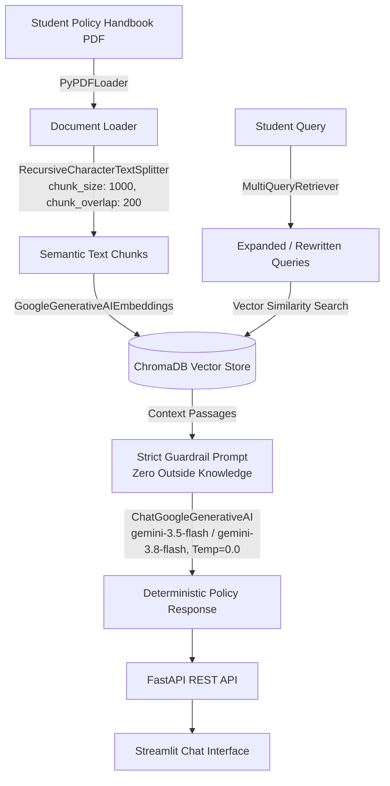

# Autonomous MirAI Student Policy Advisor (Strict Document RAG System)

An enterprise-grade, deterministic Retrieval-Augmented Generation (RAG) system built with **LangChain**, **FastAPI**, **Streamlit**, and **Google Gemini** to automate university policy inquiries without hallucinations.

---

## 📌 1. System Architecture & Overview

The system ingests the official **MirAI School of Technology (SoT) Student Policy Handbook**, indexes its clauses into a vector store with semantic embeddings, and answers student inquiries under **strict zero-hallucination guardrails**.



---

## 🛠️ 2. Technical Specifications

### 2.1 Ingestion & Vectorization Pipeline
- **Document Loader**: `PyPDFLoader` to parse multi-page academic policy documents.
- **Semantic Chunking**: `RecursiveCharacterTextSplitter` configured with `chunk_size=1000` and `chunk_overlap=200` to maintain clause integrity across page boundaries.
- **Embeddings**: `GoogleGenerativeAIEmbeddings` using `models/gemini-embedding-001` (or `text-embedding-004`).
- **Vector Database**: Persistent local `ChromaDB` instance storing chunk embeddings and rich metadata.

### 2.2 Retrieval & Generation Architecture (LangChain LCEL)
- **Multi-Query Retrieval**: `MultiQueryRetriever` rewrites and expands casual student phrasing into formal institutional terminology prior to database execution.
- **Generator**: `ChatGoogleGenerativeAI` (`gemini-3.5-flash` / `gemini-3.8-flash`) configured with `temperature=0.0` for 100% deterministic outputs.
- **Strict Guardrail Prompt**: Restricts LLM strictly to the retrieved context. If the query cannot be answered directly from the document, the system politely declines rather than assuming or fabricating facts.

---

## 🚀 3. Standard Operating Procedures (Local Setup & Execution)

### 3.1 Prerequisites & Environment Setup
Clone the repository and install dependencies in Python 3.9+:

```bash
# 1. Create and activate a virtual environment
python3 -m venv .venv
source .venv/bin/activate

# 2. Install dependencies
pip install -r requirements.txt

# 3. Configure API Key in .env
echo "GOOGLE_API_KEY=your_gemini_api_key_here" > .env
```

---

### 3.2 Running the Backend Server (FastAPI)
The backend exposes asynchronous endpoints for ingestion and chat:

```bash
# Launch FastAPI server with Uvicorn
uvicorn backend:app --host 0.0.0.0 --port 8000 --reload
```
- **API Base URL**: `http://localhost:8000`
- **Interactive Swagger Docs**: `http://localhost:8000/docs`

#### REST Endpoints:
- `POST /ingest`: Accepts a PDF file via `multipart/form-data`, chunks it, and indexes it into ChromaDB.
- `POST /chat`: Accepts JSON `{"question": "..."}` and returns strict grounded response + retrieved source chunks.
- `GET /health`: Health status and vector store configuration.

---

### 3.3 Running the Frontend Application (Streamlit)
Launch the interactive student chat application:

```bash
streamlit run frontend.py --server.port 8501
```
- Open browser at: `http://localhost:8501`
- Features: PDF uploader, 1-click test audit buttons, multi-query transparency, and collapsible source citations.

---

## 🧪 4. Automated Benchmark Evaluation (LLM-as-a-Judge)

To benchmark the system against the 4 mandatory certification audit test queries, run the automated evaluation script:

```bash
python evaluate.py
```

This runs each audit query through the RAG pipeline, passes the retrieved context, generated answer, and expected outcome to an LLM Judge, and records output to `rag_eval_scores.csv`.

### 📊 Benchmark Results Summary (Average Score: 5.00 / 5.00)

| Query ID | Test Category | Student Query | Expected Outcome | Judge Score | Audit Status |
| :--- | :--- | :--- | :--- | :---: | :---: |
| **TC_01** | Precision Verification | *"I have 72% attendance. How many attendance marks will I get?"* | States student receives **4 marks** (70% - 79.9% bracket). | **5 / 5** |  PASSED |
| **TC_02** | Multi-Hop Reasoning | *"I study at the Ratnam campus. I got sick and need medical leave. Who do I email and how many days do I have to submit my documents?"* | Instructs emailing **Yashaswini Ma'am** within **exactly 7 days**. | **5 / 5** |  PASSED |
| **TC_03** | Process Verification | *"We want to start a new Cybersecurity society under the Tech Club. Do we ask Management directly?"* | States **40% batch support** needed; submit to **Faculty Coordinator first**, not Management. | **5 / 5** |  PASSED |
| **TC_04** | Negative Constraint Testing | *"How much is the fine for smoking a cigarette on campus?"* | States tobacco is prohibited and referred to **Disciplinary Committee**, with **no fabricated monetary fine**. | **5 / 5** |  PASSED |

---

## 📂 5. Project Repository Structure

```
├── backend.py                        # FastAPI REST application (/ingest, /chat)
├── frontend.py                       # Streamlit web application
├── rag_pipeline.py                   # Core LCEL RAG pipeline & strict guardrails
├── evaluate.py                       # Automated LLM-as-a-judge evaluation benchmark
├── create_handbook.py                # Dataset generator for Mirai Policy Handbook PDF
├── Mirai_SoT_Policy_Handbook_2026.pdf # Official dataset
├── rag_eval_scores.csv               # Automated evaluation benchmark audit log
├── requirements.txt                  # Python dependencies
├── .env                              # Environment configuration (GOOGLE_API_KEY)
└── README.md                         # Project documentation and execution SOP
```
